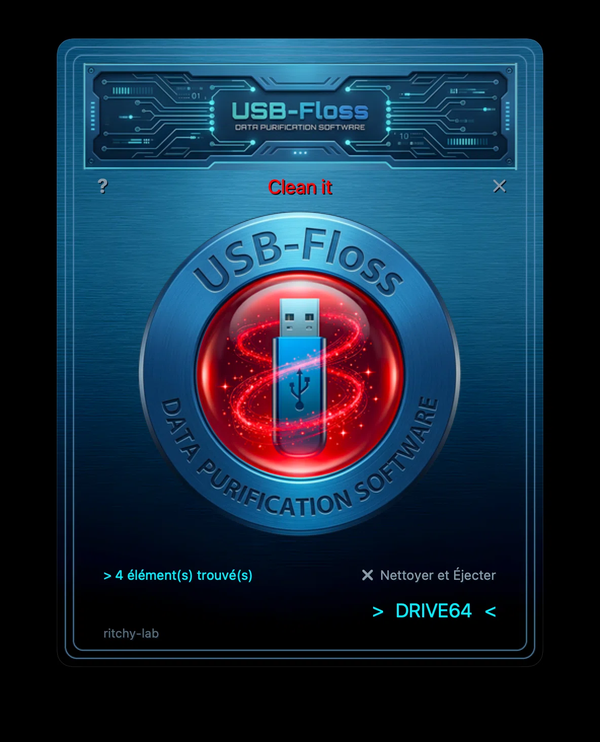
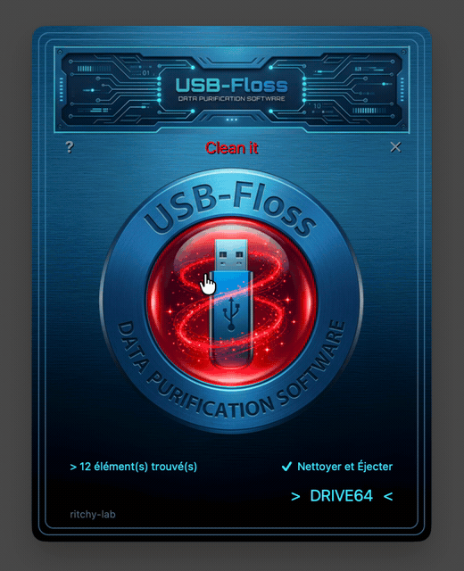
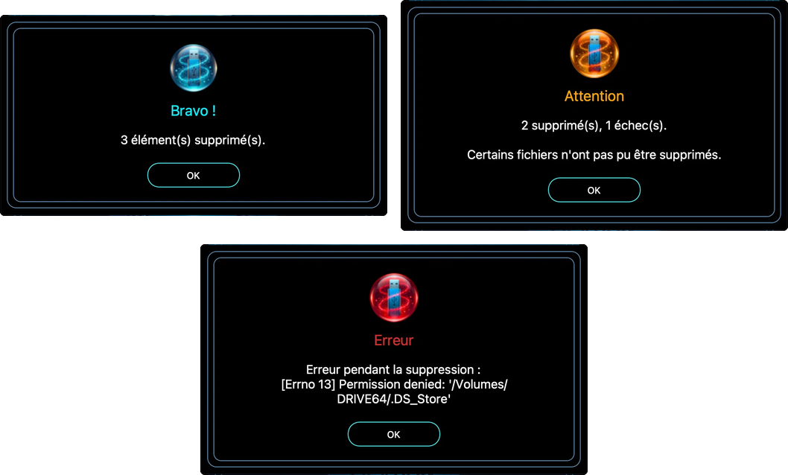

# USB-Floss Magic

Cleans a USB drive of the useless files that macOS, Windows or Linux leave
behind: `.DS_Store`, `._file`, `Thumbs.db`, `Desktop.ini`, `.Spotlight-V100`…

🇫🇷 **[Version française](README.md)**

Made for drives that travel back and forth between a Mac and a PC: one click and
the drive is clean again — and **these files recreate themselves if the system
needs them, so no data is ever lost**.



## Download

The ready-to-use version (macOS app for **Apple Silicon**, M1 and later) is in
[**Releases**](https://github.com/ritchy-lab/USB-Floss-Magic/releases/latest):
download the `.zip`, unzip it, then drag the application into `Applications`.

⚠️ The application is not signed with a paid Apple certificate, so macOS shows a
warning on first launch. To open it anyway: **right-click the application →
Open**, then confirm. If macOS still refuses (macOS 15 and later):
**System Settings → Privacy & Security**, then "Open Anyway" at the bottom of
the window.

## What the application does

- detects the plugged-in USB drives and small external disks automatically
  (under 256 GB, excluding Time Machine disks);
- shows the number of junk files found;
- deletes them with one click on the central button;
- can eject the drive right after cleaning ("Clean and Eject" tick box);
- click on "X item(s) found" to see the full list.

The interface speaks French or English depending on the language of your Mac.

## In action



## Messages

The application keeps you informed without ever alarming you:



## Installation (to run from the source)

You need **Python 3.10 or later** and **macOS** (volumes are read from
`/Volumes`).

```bash
pip install -r requirements.txt
python3 usb-floss-magic.py
```

## Command-line version

```bash
python3 usbfloss.py                                  # menu: pick the drive
python3 usbfloss.py /Volumes/MY_DRIVE                # preview, deletes nothing
python3 usbfloss.py /Volumes/MY_DRIVE --delete       # deletes (asks to confirm)
python3 usbfloss.py /Volumes/MY_DRIVE --delete --yes # deletes without confirmation
```

## Safety

- the application refuses to clean the disk root (`/`) or any folder that
  contains your home folder: it only works on a USB drive or a small external
  disk;
- every deletion checks that the file really is **inside** the selected drive,
  and never the drive itself;
- folders managed by macOS (`.Spotlight-V100`, `.Trashes`, `.fseventsd`…) are
  listed but never deleted;
- the files being cleaned (`.DS_Store`, `._*`…) are recreated automatically by
  the system when needed: deleting them breaks nothing.

## Building the macOS application (.app)

```bash
./build.sh
```

The script compiles, removes the `com.apple.FinderInfo` attributes that the
Finder puts on the bundle, signs it ad-hoc, verifies the signature, then builds
the release zip. Without that cleaning and signing, the bundle ships with an
incomplete signature — and macOS then shows a fallback icon instead of the real
one.

Manual equivalent:

```bash
pyinstaller --noconfirm --clean "USB-Floss Magic.spec"
xattr -cr "dist/USB-Floss Magic.app"
codesign --force --deep --sign - "dist/USB-Floss Magic.app"
ditto -c -k --norsrc --noextattr --noacl --keepParent \
  "dist/USB-Floss Magic.app" "dist/USB-Floss-Magic-0.7-macOS-arm64.zip"
```

The result is in `dist/USB-Floss Magic.app`. The images (`background.png`,
`logo.png`, `button_*.png`, `popup_*.png`) must stay next to the script.

> **Note on architecture**: a *universal* build (Intel + Apple Silicon) is
> blocked by Pillow, which is not distributed as a universal binary on PyPI.
> The spec therefore compiles for the architecture of the machine. For an Intel
> Mac, you need an x86_64 Python environment (under Rosetta) and rebuild there.

> **Note on the icon and macOS 26**: macOS 26 (Tahoe) may redraw the icons of
> applications that do not follow its new "squircle" template. This project
> deliberately uses its own round cut-out icon (`icon.icns` + `icon.png`): it
> covers every size from 16 to 512 px with transparent corners. Adopting the
> macOS 26 "Liquid Glass" icon would require an *Icon Composer* (`.icon`) file
> compiled with Xcode 26.

If anything goes wrong with the `.app` version, error messages are written to
`~/Library/Logs/USB-Floss Magic.log`.

## Tests

```bash
python3 test_usbfloss.py
```

## Support the project

USB-Floss Magic is free, with no ads and no trackers. If the app was useful to
you, you can buy me a coffee ☕:

[**ko-fi.com/ritchy_lab**](https://ko-fi.com/ritchy_lab)

## Licence

MIT — © 2026 ritchy-lab
